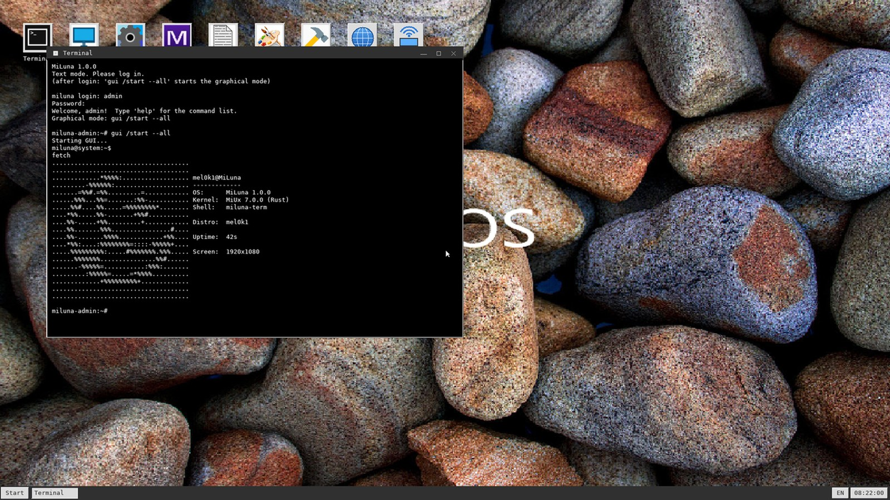
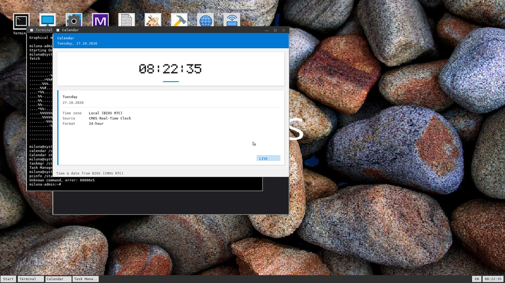
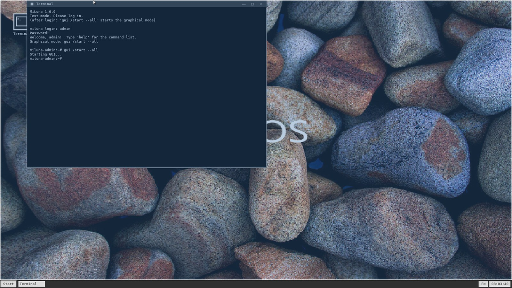
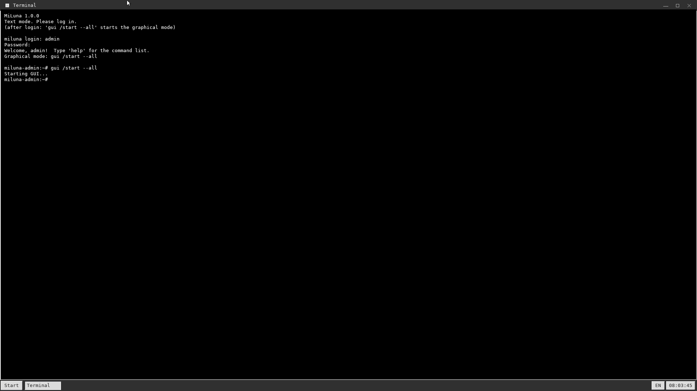
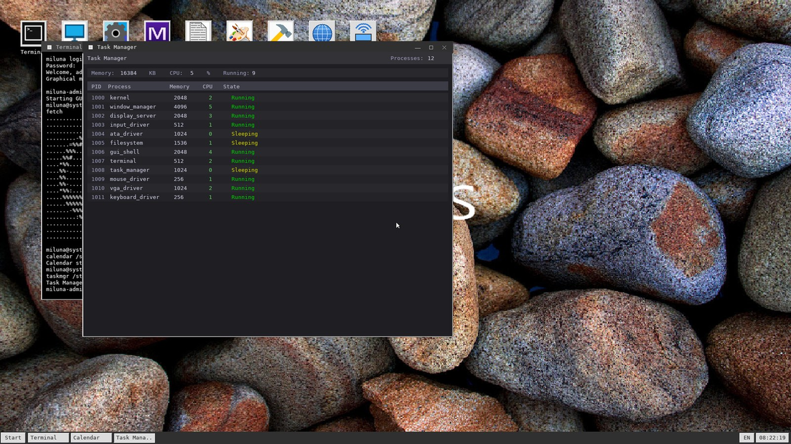
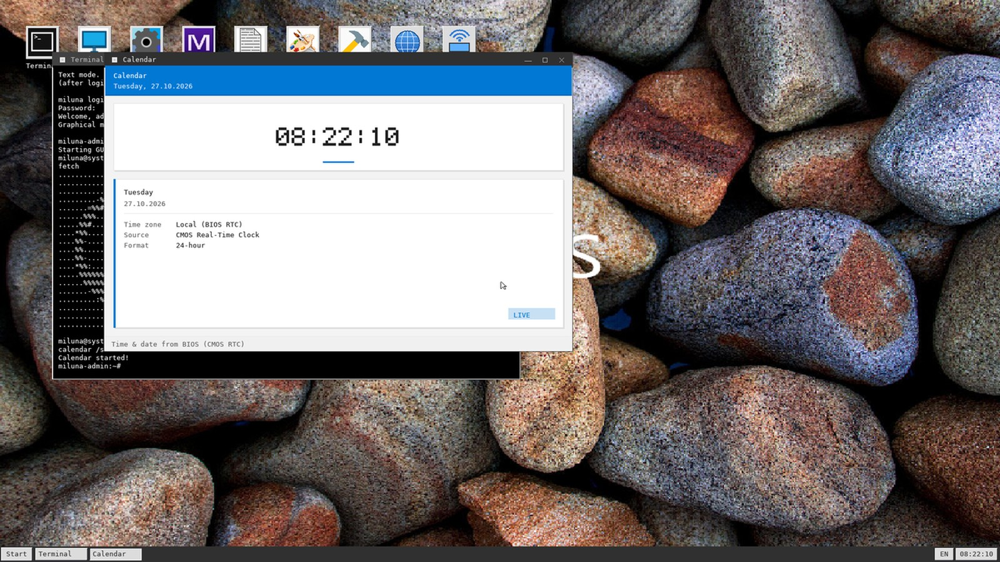
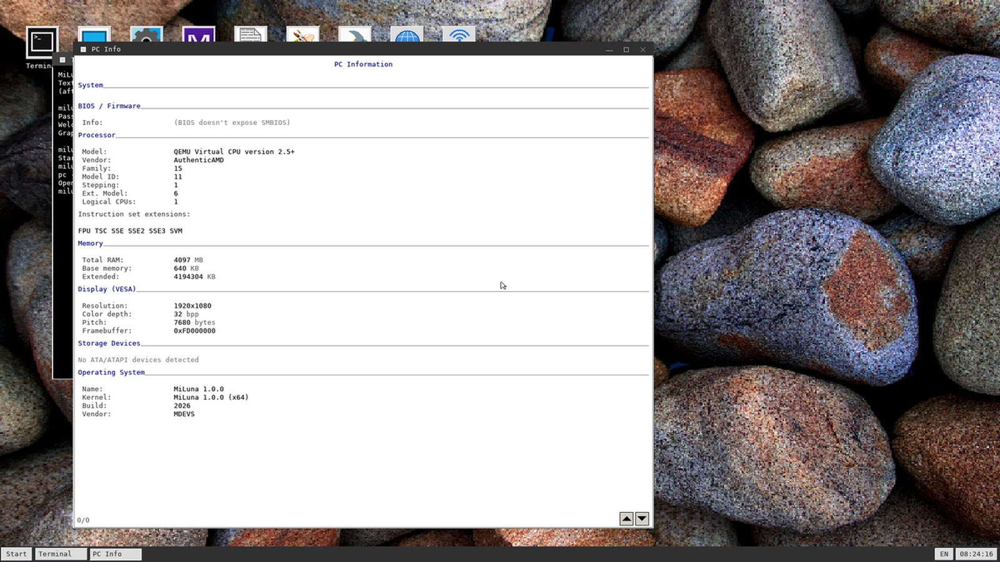
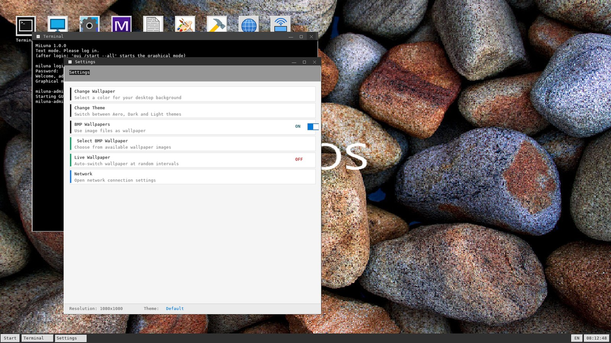

<div align="center">


# MiLuna 🌙

**Дистрибутив операционной системы для x86_64 на ядре [MiUx](https://github.com/mel0k1/MiLuna) 7.0.0**

Rust-ядро · оконный менеджер на C · SSE2 · GRUB 2 · браузер · сеть · FAT32


</div>

---

## О проекте

**MiLuna** — любительский дистрибутив ОС, построенный на базе ядра **MiUx 7.0.0** от команды MDEVS. Из коробки вы получаете полноценную live-систему с текстовым терминалом, графической оболочкой с оконным менеджером, собственным веб-браузером, сетевым стеком с HTTPS и установщиком на жёсткий диск.

Проект собирается одной командой `make` в гибридный ISO-образ (загружается и по Legacy BIOS, и по UEFI), а GitHub Actions автоматически собирает `MiLuna.iso` на каждый коммит и прикладывает его к релизам по тегам.

## Возможности

**Ядро и железо**
- Ядро на Rust (`no_std`), загрузка через GRUB 2 (multiboot2, VBE/VESA 1920x1080)
- SSE/SSE2 включаются в загрузчике: аппаратная FP-арифметика для браузерного движка и GL, быстрые `memcpy`/`memset`
- Реальные данные железа: память из memory map multiboot, uptime через TSC
- Линейный фреймбуфер, частичная перерисовка экрана (fastblit)
- Клавиатура, мышь (включая колесо), ATA, SATA, ATAPI, PCI
- Файловые системы: FAT32 (чтение и запись), EXT4 (просмотр), TAR initrd
- Пользователи: вход, `useradd`, `userdel`, `passwd`

**Графический интерфейс** (`gui /start --all`)
- Оконный менеджер на C: рамки, тени, свернуть/развернуть/закрыть, панель задач, меню «Пуск», часы
- Полноценный рабочий стол: обои (BMP), иконки приложений, папки и ярлыки, контекстное меню
- **Alt+Tab** — переключение окон, **Aero Snap** — перетащите окно к верхнему или боковому краю экрана
- Подсветка кнопок заголовка при наведении мыши, живые часы в панели задач (RTC)
- 4 темы: Aero, Basic, Classic, Ubuntu
- Раскладка EN/RU (`Alt+Shift`), рабочий стол с папками и ярлыками
- Экран паники ядра с диагнозом исключения (вектор, имя, CR2, RIP) вместо молчаливого зависания

**Приложения**
- Terminal, Notepad, Paint (сохранение в `.bmp`), File Manager
- Settings, Network, Browser, Task Manager, Calendar, Clock
- Cre Tool (конструктор приложений), GL (3D-шестерёнки), HTML Viewer, Support Center, BMP-просмотр

**Сеть и интернет**
- Intel e1000, Realtek RTL8139, RTL8169
- Стек TCP/IP на smoltcp: DHCP, DNS, TCP, UDP, ICMP
- HTTP и HTTPS (TLS 1.3), перенаправления, gzip, cookies
- Собственный браузерный движок: HTML, CSS (селекторы, flex, grid), картинки PNG/JPEG/BMP, формы

## Скриншоты

| | |
|---|---|
|  |  |
|  |  |
|  |  |
|  |  |

Aero Snap: перетащите окно к верхнему краю — развернётся на весь экран, к левому или правому — займёт половину.

## fetch

Традиционный `fetch` с фирменной луной доступен прямо в терминале (uptime и разрешение экрана — настоящие):

```
.....................................
.....................................
.............*%%%%:.................. mel0k1@MiLuna
.........-%%%%%%:.................... -------------
.......=%%#.=%%.........=............ OS:      MiLuna 1.0.0
......%%%...%%=.......:%%-........... Kernel:  MiUx 7.0.0 (Rust)
.....%%#....%%.....=%%%%%%%%*........ Shell:   miluna-term
....*%%.....%%-.......+%%#...........
....%%-.....+%%.........+............ Distro:  mel0k1
....%%.......%%%................#....
....%%-.......%%%%............+%%.... Uptime:  42s
....*%%:....:%%%%%%%%=::::-%%%%%+....
.....%%%%%%%%%:.....#%%%%%%%.%%%..... Screen:  1920x1080
......%%%%%%%...............%%#......
.......-%%%%%=...........:%%%:.......
.........:%%%%%=.....=*%%%%..........
.............+%%%%%%%%%+.............
.....................................
.....................................
```

## Сборка

Нужны Linux, nightly Rust, NASM, GRUB и утилиты для ISO:

```bash
sudo apt update
sudo apt install -y build-essential nasm grub-pc-bin grub-efi-amd64-bin \
                    grub-efi-ia32-bin grub-common xorriso mtools dosfstools

curl --proto '=https' --tlsv1.2 -sSf https://sh.rustup.rs | sh
source ~/.cargo/env

make setup    # nightly, rust-src, target x86_64-unknown-none
make          # собирает MiLuna.iso
```

Или просто заберите готовый `MiLuna.iso` со страницы [Actions](https://github.com/mel0k1/MiLuna/actions) — CI собирает образ на каждый коммит. На тегах `v*` ISO автоматически прикладывается к релизу.

## Запуск

```bash
make run
```

Или вручную, с сетью:

```bash
qemu-system-x86_64 -cdrom MiLuna.iso -m 1024M -vga std -nic user,model=e1000
```

Нужно не меньше 512 МБ памяти. Можно взять `model=rtl8139`.

### Запуск с FAT32-диском

```bash
make fat32-disk   # создаёт fat32.img (100 МБ)
make run-fat32    # диск + ISO
```

### Меню GRUB

- **Boot MiLuna (LiveCD)** — запуск системы
- **Install MiLuna** — установщик на диск
- **Reboot**, **Shutdown**

## Установка на диск

1. Загрузитесь с ISO и выберите «Install MiLuna».
2. Выберите диск и подтвердите установку.
3. Установщик копирует ядро в папку `MiLuna`, ставит GRUB и создаёт `system.cfg`.
4. Загрузитесь с установленного диска.

## Команды терминала

Полный список: `help`.

| Группа | Команды |
|---|---|
| Система | `ver`, `fetch`, `uptime`, `mem`, `about`, `tech`, `kernel`, `pc --info` |
| Пользователи | `login`, `logout`, `whoami`, `users`, `useradd`, `userdel`, `passwd` |
| Файлы | `dir`, `ls`, `cd`, `cat`, `disks`, `mount`, `format`, `fs` |
| EXT4 | `ext4`, `ext4ls`, `ext4cat`, `ext4info` |
| Сеть | `ifconfig`, `nslookup`, `wget`, `net` |
| Браузер | `browser [адрес]` |
| Приложения | `call`, `list-apps`, `gui /start --all`, `notepad /start`, `gl /start` |
| Экран | `display /scr 1920x1080`, `display /scr default` |

## Структура проекта

```
MiLuna/
├── src/
│   ├── lib.rs          ядро: главный цикл, терминал, приложения
│   ├── boot.asm        загрузчик (long mode, таблицы страниц, GDT)
│   ├── ui/             оконный менеджер на C (wm.c, gfx.c, taskbar.c)
│   ├── cui.rs, wm.rs   мост Rust <-> C и логика окон
│   ├── graphics.rs, vesa.rs, fastblit.rs   графика
│   ├── fs/             fat32.rs, ext4.rs, tar.rs
│   ├── net/            e1000, rtl8139, rtl8169, wifi, http
│   ├── web/            движок браузера
│   ├── installer.rs    установщик
│   └── syscfg.rs       system.cfg: настройки
├── assets/             иконка MiLuna
├── initrd/             содержимое initrd
├── tools/gen_fonts.py  генератор шрифтов
└── Makefile, linker.ld, Cargo.toml
```

## Roadmap

**Готово**
- [x] Реальные значения `mem` из memory map multiboot, `uptime` через TSC
- [x] SSE/SSE2: включены в загрузчике (CR0/CR4) и target features
- [x] Экран паники ядра (вектор, имя исключения, CR2, RIP) вместо `hlt`
- [x] Полный рабочий стол: панель задач, меню «Пуск», иконки, обои
- [x] Alt+Tab и Aero Snap (верх/лево/право с превью зоны)

**Дальше**
- [ ] Ring 3: TSS, `syscall`/`sysret`, пользовательские страницы (U/S), ELF-загрузчик
- [ ] Вытесняющая многозадачность: PIT/LAPIC-таймер, контекст-свитч из прерывания
- [ ] SMP: парсинг MADT, INIT-SIPI, per-CPU области, блокировки
- [ ] NX-бит и защита ядерных страниц
- [ ] HPET/LAPIC-таймер вместо busy-wait `sleep`, ACPI poweroff
- [ ] Больше окон одновременно (сейчас 8), damage-tracking во всём композиторе
- [ ] Постепенный отказ от `static mut` в пользу безопасных абстракций
- [ ] Сжатие встроенных BMP-ресурсов (сейчас 4+ МБ)
- [ ] Проверка TLS-сертификатов в HTTPS
- [ ] Драйверы конкретных Wi-Fi карт

## Кредиты

MiLuna построена на ядре **MiUx 7.0.0**, написанном **Mikhail** и командой **MDEVS**. Спасибо за отличную базу!

- Ядро MiUx и его автор: MDEVS
- Дистрибутив MiLuna: **mel0k1**

## Лицензия

[Apache-2.0](LICENSE). Права на исходное ядро MiUx принадлежат его авторам.
